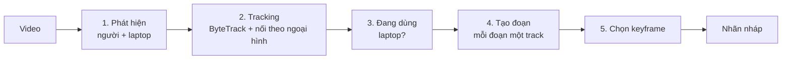

# Auto label – LapUse QC

Cập nhật 30/09/2026 · Chạy được cho từng video, chọn được YOLO26s hoặc YOLO26x; chưa có chạy hàng loạt

## Mục tiêu

Giảm thời gian gán box ở bước 3 của [luồng QC](luong-qc.md). Model tự đề xuất sẵn người đang sử dụng laptop: track, đoạn thời gian và box ở một số keyframe. Người gán chỉ kiểm tra, sửa và xác nhận, thay vì vẽ từ đầu.

## Cách dùng

1. Mở một video chưa gán nhãn ở trang Gán nhãn, chọn model trong ô cạnh nút (**YOLO26s** mặc định hoặc **YOLO26x**), bấm **✨ Auto label**. Nút hiện tên model và phần trăm tiến độ; trong lúc chạy không sửa được nhãn của video đó.
2. Khi xong, các người model đề xuất hiện trên video với khung nét đứt, nhãn "AI 0.95" (độ tin cậy), và trong danh sách sự kiện với nhãn "AI · chưa xác nhận". Ô tiến độ của video chuyển sang **✨ Chờ xác nhận**.
3. Xem từng người: sửa box hoặc đoạn nếu sai (sửa là tự tính đã chấp nhận), xoá nếu đề xuất nhầm, hoặc bấm **✓ Chấp nhận** (phím `A`). Có nút **✓ Chấp nhận tất cả**.
4. Tự vẽ thêm những người model bỏ sót, rồi bấm `Enter` để đánh dấu đã gán xong.

Video còn track auto chưa xác nhận thì chưa tính là xong và bị bỏ qua khi đánh giá model.

## Cách làm hiện tại

| Thành phần | Lựa chọn | Lý do |
| --- | --- | --- |
| Detector | **YOLO26s** (mặc định) hoặc **YOLO26x** của Ultralytics, huấn luyện trên COCO | YOLO26s nhanh gấp khoảng 9 lần Faster R-CNN dùng trước đó và nhận ra laptop ổn định. YOLO26x (bản lớn nhất) để thử so sánh (xem bên dưới). RT-DETR-L đã thử và bỏ khỏi danh sách vì hay nhận nhầm laptop. Model mặc định đặt bằng `AUTOLABEL_MODEL`, danh sách chọn ở `MODEL_CHOICES` trong `detector.py` |
| Đối tượng phát hiện | Chỉ **person** và **laptop** (`Params.device_labels`) | Bài toán là người sử dụng laptop; người dùng máy để bàn không được đề xuất. Muốn tính cả máy để bàn thì thêm `"keyboard", "mouse"` |
| Lấy mẫu | 10 frame mỗi giây (`AUTOLABEL_SAMPLES_PER_SECOND`), bước = fps / 10 làm tròn (video 25 fps lấy mỗi 2 frame) | Thời điểm đầu / cuối đoạn chính xác tới khoảng 0,1 giây; chạy lâu gấp khoảng 2 lần so với 5 frame mỗi giây |
| Thiết bị cố định | Gom các lần phát hiện laptop trên toàn video thành "bản đồ thiết bị" | Camera đứng yên, detector hay bỏ sót laptop ở một số frame (bị che, góc nghiêng) |
| Đang dùng? | Laptop nằm trong box người (nới 10%) **và** tâm laptop ở phần thân, từ 25% tới 95% chiều cao box | Loại trường hợp laptop gập trên bàn phía sau, ngang đầu người đang ngồi nói chuyện |
| Tracking | **Đang thử ByteTrack** (mặc định, `Params.tracker = "bytetrack"`, file `bytetrack.py`): lọc Kalman + ghép IoU hai lượt, lượt hai dùng box người điểm thấp (0,1–0,5) để giữ người bị che một phần; chỉ box từ 0,6 mới tạo track mới; sau đó vẫn nối mảnh vụn theo ngoại hình. Cách cũ (`tracker = "appearance"`): ghép theo vị trí (IoU hoặc khoảng cách tâm) **và** ngoại hình; giữ track 2 giây khi mất dấu; sau cùng nối các mảnh vụn cùng ngoại hình cách nhau dưới 3 giây | Chỉ theo vị trí thì khi người này đi ngang che người kia, track bị chuyển sang người đi ngang. Đã so với BoT-SORT + ReID của ultralytics: ít track vụn hơn nhưng nhầm người nhiều hơn, mà với auto label nhầm người tệ hơn bị vụn |
| Tạo đoạn | Lấp khoảng hở dưới 1 giây, bỏ đoạn ngắn hơn 1 giây; **mỗi đoạn liên tục là một track riêng** | Ngừng dùng máy lâu hơn 1 giây rồi dùng lại thì thành track mới; track đánh số theo thời điểm bắt đầu |
| Chạy nền | Trong tiến trình API, mỗi lúc một video; dùng chung khoá với việc chạy model khi đánh giá | Đủ cho một người dùng; nhiều video thì chuyển sang worker riêng (thiết kế ở cuối tài liệu) |

**So ngoại hình:** với mỗi box người, cắt vùng áo (15–50% chiều cao) và vùng quần (50–85%), bỏ 20% mỗi mép trái phải để bớt lẫn nền; tính histogram màu HSV cho từng vùng rồi so bằng hệ số Bhattacharyya (1 là giống hệt). Ghép từng frame cần ≥ 0,88, nối mảnh vụn cần ≥ 0,92. Đo trên video mẫu: cùng một người ở hai frame liền nhau thì 95% trên 0,95, hai người khác nhau cao nhất 0,85. Hai người mặc đồ cùng màu (đồng phục) thì gần như không phân biệt được bằng cách này, chỉ còn dựa vào vị trí. Mọi ngưỡng nằm trong `Params` ở `backend/app/services/autolabel/pipeline.py`.

## Kết quả thử

Video `day_1 - Trim.mp4`: 52 giây, 25 fps, 720p, lấy mẫu mỗi 2 frame (654 frame), CPU 8 nhân, không GPU.

| | YOLO26s | RT-DETR-L |
| --- | --- | --- |
| Thời gian mỗi frame | 174 ms | 765 ms (chậm gấp khoảng 4,4 lần) |
| Cả video | khoảng 2 phút | khoảng 8,5 phút |
| Frame thấy laptop (ngưỡng 0,3) | 407 / 654 | 589 / 654 |
| Track đề xuất | 4 | 10 |

- **YOLO26s:** các đoạn 868–1010, 1100–1154, 1198–1306 là người áo caro gõ laptop, khớp với đoạn người gán đã xác nhận ở lần chạy trước. Đoạn 1056–1090 là lúc người này quay sang máy để bàn trong khi laptop vẫn trong tầm tay, cần người gán xem lại. Người bị che khuất vẫn giữ đúng track (tới 2 giây), nhưng box lúc bị che có thể dài ra trùm cả người đứng trước.
- **RT-DETR-L:** tách người ngồi sát nhau tốt hơn (YOLO có lúc gộp hai người vào một box), nhưng "thấy laptop" ở vật khác trên bàn với độ tin cậy 0,4 đến 0,5, nên phần lớn các đoạn chỉ RT-DETR đề xuất là nhầm (người dùng máy để bàn, người ngồi trước bàn có laptop, người cầm điện thoại). Nếu dùng RT-DETR thì cần nâng ngưỡng laptop (`Params.device_score`, đang đặt cho YOLO là 0,3).
- **YOLO26x** (đo nhanh trên 30 frame trải đều của cùng video, CPU): 1.202 ms mỗi frame so với 222 ms của YOLO26s (chậm gấp khoảng 5,4 lần, cả video khoảng 13 phút); thấy laptop ở 26/30 frame so với 19/30; số người phát hiện gần như nhau. Chưa chạy cả pipeline để so track và chưa xem bằng mắt.
- Chưa đo được độ chính xác thật của auto label vì video thử chưa có nhãn vẽ tay độc lập (nhãn đang có là kết quả auto label được xác nhận).

## Cài đặt

```bash
pip install torch torchvision --index-url https://download.pytorch.org/whl/cpu   # máy không có GPU NVIDIA
pip install -r backend/requirements-autolabel.txt
```

Cần `ffmpeg` trong `PATH` để đọc frame. Lần chạy đầu với mỗi model tự tải trọng số vào `backend/storage/models/` (`yolo26s.pt` khoảng 20 MB, `yolo26x.pt` khoảng 119 MB). Mạng chập chờn thì tải bị đứt; khi đó tải tay bằng `curl -L -C -` từ `https://github.com/ultralytics/assets/releases/download/v8.4.0/<tên file>` rồi đặt vào thư mục trên. Model nhận ra RT-DETR theo tên file (có `rtdetr`), vì nạp RT-DETR như YOLO thì hậu xử lý sai. Chưa cài thư viện thì nút báo lỗi 503 kèm lệnh cài, phần còn lại của ứng dụng vẫn chạy bình thường.

**Giấy phép:** `ultralytics` và trọng số YOLO26 dùng **AGPL-3.0**; RT-DETR chạy qua `ultralytics` cũng theo AGPL-3.0 (chỉ bản gốc `lyuwenyu/RT-DETR` là Apache-2.0). Dùng nội bộ để gán nhãn thì thường không vấn đề, nhưng đưa vào sản phẩm thương mại hoặc dịch vụ mà không công khai mã nguồn thì cần giấy phép Enterprise của Ultralytics. Cần team xác nhận trước khi dùng ngoài phạm vi thử nghiệm.

## Giới hạn hiện tại

- Trạng thái job chỉ giữ trong bộ nhớ: khởi động lại backend trong lúc chạy thì phải bấm lại.
- Chỉ chạy trên video chưa có nhãn do người gán (hoặc chỉ có nhãn auto chưa xác nhận, sẽ bị thay bằng kết quả mới); video đã có nhãn tay thì từ chối để không ghi đè.
- Người đứng cạnh hoặc che khuất laptop có thể bị coi là đang dùng máy; người gán cần xoá những đề xuất này. Muốn giảm thì cần thêm model nhận dạng tư thế (ví dụ YOLO26 pose) để biết người đang ngồi hay đứng, tay có đặt lên laptop không.
- Tư thế cầm hoặc mang máy dễ bị bỏ sót hơn tư thế ngồi gõ máy, vì model COCO không được huấn luyện riêng cho việc "dùng laptop".
- Chưa có chạy hàng loạt nhiều video, chưa thống kê tỷ lệ box do model tạo trong các video đã xác nhận.

## Nguyên tắc

1. **Nhãn tự động chỉ là nháp.** Người gán phải xác nhận thì mới được tính; video còn track auto chưa xác nhận bị bỏ qua khi đánh giá.
2. **Không ghi đè nhãn tay.** Video đã có nhãn do người gán thì không chạy auto label, trừ khi xoá nhãn cũ trước.
3. **Model gán nháp phải khác model đang được đánh giá.** Nếu dùng chính model cần đánh giá để tạo nhãn, GT mang theo đúng lỗi của model đó và precision / recall sẽ cao giả tạo.
4. **Giữ một tập đối chứng gán tay hoàn toàn** để đo xem nhãn tự động sai đến đâu.

## Pipeline



| Bước | Cách làm | Kết quả |
| --- | --- | --- |
| 1. Phát hiện | YOLO26s hoặc YOLO26x (COCO) trên các frame lấy mẫu, chỉ lớp `person` và `laptop` | Box người (kèm đặc trưng ngoại hình) và laptop ở từng frame |
| 2. Tracking | ByteTrack (hoặc cách cũ: vị trí + ngoại hình), giữ track khi mất dấu ngắn, nối mảnh vụn theo ngoại hình | Mỗi người một chuỗi box qua các frame |
| 3. Đang dùng laptop? | Luật: laptop (cố định trên bàn hoặc thấy ở frame đó) nằm ở phần thân trong box người | Dùng / không dùng của từng người ở từng frame |
| 4. Tạo đoạn | Lấp khoảng hở dưới 1 giây, bỏ đoạn ngắn hơn 1 giây; mỗi đoạn liên tục một track | Track có đúng một `segments` gồm `start`, `end` |
| 5. Chọn keyframe | Làm mượt box, chỉ giữ những frame mà nội suy tuyến tính giữa chúng vẫn khớp box phát hiện (IoU ≥ 0,8) | Vài keyframe mỗi đoạn |

Bước 5 giúp kết quả khớp đúng định dạng nhãn hiện có (track, đoạn, keyframe, nội suy), nên các thao tác kéo box, tua đầu cuối đoạn trên trang Gán nhãn dùng được nguyên.

## Dữ liệu

Mỗi track biết nó từ đâu ra và đã được xác nhận chưa. Mỗi box do model tạo có kèm độ tin cậy.

```json
{
  "track_id": 3,
  "origin": "auto",
  "confirmed": false,
  "segments": [{ "start": 120, "end": 480 }],
  "keyframes": {
    "120": { "x": 0.31, "y": 0.22, "w": 0.12, "h": 0.40, "confidence": 0.82 },
    "480": { "x": 0.35, "y": 0.24, "w": 0.12, "h": 0.38, "confidence": 0.77 }
  }
}
```

| Trường | Ý nghĩa |
| --- | --- |
| `origin` | `human` hoặc `auto`. Không bao giờ đổi, để thống kê được tỷ lệ box gốc do model tạo |
| `confirmed` | Track tự động mới tạo là `false`. Thành `true` khi người gán bấm chấp nhận hoặc chỉnh box, đoạn của track. Track người vẽ luôn là `true` |
| `confidence` | Độ tin cậy của model cho box đó, chỉ có ở box tự động |

File nhãn có thêm `auto_label`: tên model (ví dụ `Ultralytics yolo26x.pt (COCO)`), thời điểm chạy, bước lấy mẫu. File nhãn cũ đọc vào được coi là `origin: human`, `confirmed: true`.

## Code

| File | Việc |
| --- | --- |
| `backend/app/services/autolabel/detector.py` | Nạp model (YOLO hoặc RT-DETR theo tên file, mỗi model một lần), đọc frame bằng ffmpeg, tính đặc trưng ngoại hình, danh sách model chọn được |
| `backend/app/services/autolabel/pipeline.py` | Bước 2 tới 5, hàm thuần, mọi ngưỡng trong `Params`; test bằng dữ liệu giả không cần torch |
| `backend/app/services/autolabel/jobs.py` | Chạy nền mỗi lúc một video, giữ tiến độ, ghi kết quả vào file nhãn |
| `backend/app/api/v1/endpoints/autolabel.py` | `GET /autolabel/models`, `POST /uploads/{id}/autolabel` (body tuỳ chọn `{"model": ...}`), `GET /uploads/{id}/autolabel` |

## Thiết kế cho giai đoạn sau (chưa làm)

**Worker riêng.** Mỗi video mất vài phút và model nên nằm sẵn trong bộ nhớ, thường là GPU. Khi chạy nhiều video, chuyển job sang một tiến trình riêng (`python -m app.worker`) đọc hàng đợi lưu trên đĩa (ví dụ `storage/jobs.json`), để job không mất khi khởi động lại API và API không bị chậm.

**Chạy hàng loạt.** Chọn nhiều video trong một project rồi bấm "Auto label"; API dự kiến:

| Method | Đường dẫn | Mô tả |
| --- | --- | --- |
| POST | `/autolabel/batch` | Tạo job cho nhiều video, bỏ qua video đã có nhãn tay |
| GET | `/autolabel/jobs?upload_id=` | Trạng thái `queued`, `running`, `done`, `error` và tiến độ |
| DELETE | `/autolabel/jobs/{id}` | Huỷ job đang chờ |

**Thống kê:** ghi tỷ lệ box có `origin: auto` và tên model gán nháp vào kết quả mỗi lượt đánh giá, để biết GT phụ thuộc vào model đến đâu.

## Kế hoạch

| Giai đoạn | Việc | Trạng thái |
| --- | --- | --- |
| 1. Thử nghiệm | `pipeline.py`, chạy trên video mẫu, so các cách tracking và detector | Xong |
| 2. Tích hợp | Job nền, API, `origin` / `confirmed` trong nhãn, nút Auto label, hiển thị và xác nhận track tự động, chọn model, bỏ qua video chưa xác nhận khi đánh giá | Xong |
| 3. Mở rộng | Worker riêng, chạy hàng loạt, ngưỡng riêng cho từng model, đo độ chính xác trên tập gán tay, fine-tune model gán nháp bằng box người đã sửa, ưu tiên cho người xem những video model kém tự tin nhất | Chưa làm |

## Cần team quyết định

- [ ] **Máy chạy có GPU không?** Chỉ có CPU vẫn chạy được, nhưng video 7 phút mất khoảng 12 phút với YOLO26s (khoảng 4.200 frame lấy mẫu, 174 ms mỗi frame) và lâu hơn nhiều với YOLO26x.
- [ ] **Model gán nháp mặc định:** YOLO26s, YOLO26x hay model riêng của team? Model này phải khác model sẽ được đánh giá.
- [ ] **Giấy phép** `ultralytics` (AGPL-3.0) cho phạm vi sử dụng thực tế; nếu không được thì chuyển sang torchvision (BSD, chậm hơn) hoặc RT-DETR bản gốc (Apache-2.0). Chỉ cần sửa `detector.py`.
- [ ] **Luật "đang dùng laptop":** tiếp tục dựa vào vị trí box, hay thêm model tư thế / bộ phân loại riêng?

## Rủi ro

| Rủi ro | Cách giảm |
| --- | --- |
| GT phụ thuộc vào model, kết quả đánh giá cao giả tạo | Model gán nháp khác model được đánh giá; bắt buộc xác nhận; giữ tập đối chứng gán tay |
| Người gán bấm "Chấp nhận tất cả" mà không xem kỹ | Review mẫu theo luồng QC; theo dõi tỷ lệ track tự động bị sửa hoặc xoá |
| Model bỏ sót người ở tư thế cầm hoặc mang máy | Đo riêng các video có tư thế cầm / mang máy; người gán vẫn phải xem hết video trước khi bấm Enter (đã gán xong) |
| Chạy chậm trên máy không có GPU | Chạy ban đêm theo lô; giảm số frame lấy mẫu khi không cần thời điểm đầu / cuối đoạn quá chính xác |
