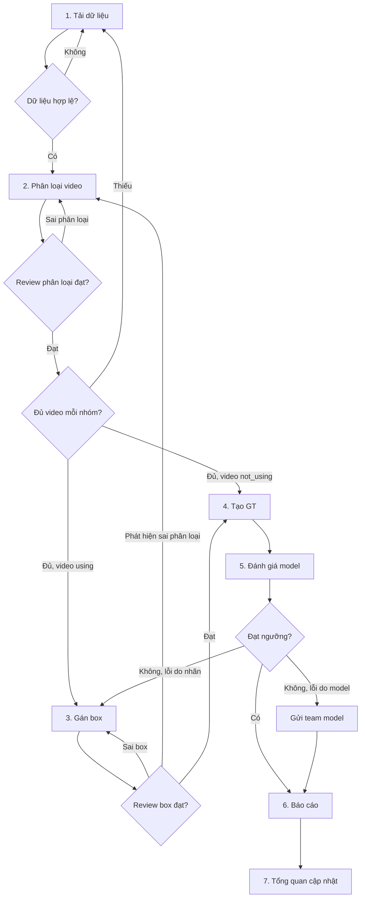

# Luồng QC – LapUse QC

Sep 25, 2026 · @Alex · cập nhật 30/09/2026

## Mục tiêu và phạm vi

Luồng QC này bảo đảm dữ liệu và model phát hiện người sử dụng laptop đạt chất lượng trước khi đưa vào dùng. "Người sử dụng" gồm mọi tư thế tương tác với laptop: ngồi gõ phím, cầm trên tay, ôm hoặc mang máy khi đang dùng.

- **Trong phạm vi:** video có laptop, phân loại của từng video, box người đang sử dụng laptop, tập ground truth (GT), kết quả đánh giá model.
- **Ngoài phạm vi:** huấn luyện model và triển khai lên hệ thống thật.

## Phân loại video

Mỗi video được phân loại **trước** khi gán box, theo hai nhóm lớn:

| Nhóm | Mã | Định nghĩa | Có cần gán box? |
| --- | --- | --- | --- |
| Có người sử dụng máy tính | `using` | Có ít nhất một người sử dụng laptop, dù chỉ trong một đoạn ngắn của video | Có |
| Không có người sử dụng máy tính | `not_using` | Suốt cả video không ai sử dụng laptop | Không |

Video chỉ chia hai nhóm trên, không chia thêm case con.

Video nửa có nửa không (ví dụ 10 giây đầu có người dùng, sau đó rời đi) xếp vào `using`. Phần không có người dùng trong video đó vẫn là negative khi đánh giá, nhờ box và đoạn thời gian gán ở bước 3.

## Sơ đồ luồng tổng thể

Luồng gồm 7 bước nối tiếp, mỗi bước có một điểm kiểm tra. Không đạt thì quay lại bước trước để sửa.

Phân loại đứng trước gán box vì ba lý do:

- Phân loại chỉ cần xem lướt video nên nhanh hơn nhiều so với vẽ box.
- Video `not_using` không cần vẽ box, đi thẳng vào GT làm negative.
- Biết sớm số video mỗi nhóm để cân đối dữ liệu trước khi tốn công vẽ box.

Sau mỗi batch, xem số video từng nhóm trên trang Tổng quan. Nhóm nào thiếu thì quay lại Tải dữ liệu để thu thập thêm cho batch sau.

Khi gán box mà thấy video bị phân loại sai (ví dụ video `using` nhưng thật ra không ai dùng máy), người gán đánh dấu và trả video về bước Phân loại, không tự đổi.

Khi model không đạt, cần tách rõ nguyên nhân. Lỗi do nhãn sai thì quay lại bước Gán box (hoặc Phân loại nếu sai nhóm). Lỗi do model thì ghi vào báo cáo và chuyển cho team model.

## Chi tiết từng bước

Mỗi bước chỉ chuyển sang bước sau khi đạt điều kiện ở cột cuối.

| Bước | Đầu vào | Việc cần làm | Đầu ra | Điều kiện qua bước |
| --- | --- | --- | --- | --- |
| 1. Tải dữ liệu | Video từ nguồn thu thập | Tải lên, kiểm tra định dạng, loại video trùng, mờ, hỏng; ghi metadata (nguồn, ngày, bối cảnh); chia thành batch nhỏ | Batch dữ liệu sạch | Không còn file lỗi, đủ metadata |
| 2. Phân loại video | Batch dữ liệu sạch | Xem lướt từng video, chọn nhóm `using` / `not_using`; người thứ hai review một phần mẫu mỗi nhóm | Nhóm của từng video + số video mỗi nhóm | Mọi video đã có nhóm; tỷ lệ sai phân loại trong mẫu review dưới ngưỡng |
| 3. Gán box | Video nhóm `using` | Đánh dấu đoạn thời gian mỗi người sử dụng laptop, vẽ box người ở các keyframe (các frame giữa tự nội suy); gắn tư thế cho từng đoạn (ngồi, cầm, mang); người thứ hai review một phần mẫu | Bộ box đã review | Tỷ lệ box sai trong mẫu review dưới ngưỡng; không còn đoạn chưa kết thúc |
| 4. Tạo GT | Video `not_using` đã phân loại + video `using` đã gán box | Chốt nhãn, xử lý các ca bất đồng; kiểm tra phân bố video theo nhóm. Trong ứng dụng, GT được dựng từ nhãn hiện tại mỗi khi chạy đánh giá và lưu lại cùng kết quả | Tập GT (chụp lại trong từng lượt đánh giá) | Mọi ca bất đồng đã có kết luận; không nhóm nào dưới mức tối thiểu |
| 5. Đánh giá model | Tập GT + model (hoặc kết quả dự đoán của model) | Đánh giá ở hai mức: mức video (model có nhận đúng video `using` / `not_using`) và mức box (precision, recall, F1 theo nhóm, và theo tư thế khi nhãn có tư thế); xem lại các ca sai; phân loại lỗi do nhãn hay do model | Bảng chỉ số theo nhóm + danh sách ca lỗi | Chỉ số đạt ngưỡng, hoặc lỗi đã được phân loại |
| 6. Báo cáo | Chỉ số + danh sách ca lỗi | Tổng hợp kết quả theo nhóm, so với lần trước, đề xuất hướng xử lý | Báo cáo QC theo phiên | Báo cáo được QC lead duyệt |
| 7. Tổng quan | Kết quả các bước trên | Cập nhật tiến độ, số video mỗi nhóm, chỉ số mới nhất lên trang Tổng quan | Dashboard hiện trạng | — |

Nhóm là nhãn cho cả video, làm ở bước 2. Box (và tư thế, khi có) là nhãn cho từng người trong từng đoạn thời gian, làm ở bước 3. Hai loại nhãn lưu riêng.

Trong GT, mọi frame của video `not_using` đều là negative. Nhờ vậy có thể đo được tỷ lệ báo nhầm (false positive) của model trên những cảnh có laptop mà không ai dùng.

## Vai trò và trách nhiệm

Bốn vai trò dưới đây là đề xuất, cần gán người cụ thể theo đội thực tế.

| Vai trò | Phụ trách bước | Trách nhiệm chính |
| --- | --- | --- |
| Người quản lý dữ liệu | 1 | Tải và làm sạch dữ liệu, quản lý metadata, chia batch và project, thu thập thêm cho nhóm thiếu |
| Người gán nhãn | 2, 3 | Phân loại video, gán box theo hướng dẫn, sửa phân loại hoặc box bị trả về, báo video bị phân loại sai |
| Reviewer | 2, 3, 4 | Review mẫu phân loại và box, kết luận các ca bất đồng, chốt GT |
| QC lead | 5, 6, 7 | Chạy đánh giá, phân loại lỗi, duyệt báo cáo, theo dõi số video mỗi nhóm, làm việc với team model |

## Tiêu chí chất lượng và ngưỡng chấp nhận

Các ngưỡng dưới đây là giá trị đề xuất để bắt đầu, cần team chốt lại.

| Tiêu chí | Bước | Ngưỡng đề xuất |
| --- | --- | --- |
| Tỷ lệ file lỗi còn lại sau khi làm sạch | 1 | 0% |
| Tỷ lệ video chưa được phân loại | 2 | 0% |
| Tỷ lệ mẫu phân loại được review | 2 | ≥ 10% mỗi nhóm trong mỗi batch |
| Tỷ lệ sai phân loại trong mẫu review | 2 | ≤ 2% sai nhóm |
| Số video tối thiểu mỗi nhóm | 2, 4 | Cần team chốt |
| Tỷ lệ mẫu box được review | 3 | ≥ 10% video `using` trong mỗi batch |
| Tỷ lệ box sai trong mẫu review | 3 | ≤ 5% |
| Độ khớp box giữa hai người gán (IoU) | 3, 4 | ≥ 0.7 |
| Precision phát hiện người dùng laptop | 5 | ≥ 0.90 |
| Recall phát hiện người dùng laptop | 5 | ≥ 0.85 |

Ngưỡng sai nhóm cần chặt, vì một video `using` bị xếp nhầm vào `not_using` sẽ không được vẽ box và trở thành negative sai trong GT.

Chỉ số ở bước 5 nên tính riêng cho từng tư thế (ngồi, cầm, mang) khi nhãn đã có tư thế, vì tư thế cầm và mang thường ít mẫu và dễ bị bỏ sót.

- [ ] Chốt ngưỡng precision và recall với team model
- [ ] Thống nhất danh sách tư thế khi gán box

## Liên kết với ứng dụng LapUse QC

Mỗi bước trong luồng tương ứng với một mục trên sidebar của ứng dụng. Ứng dụng không có chức năng review (duyệt / trả về video); việc người thứ hai review một phần mẫu ở bước 2 và 3 làm ngoài ứng dụng.

| Bước | Mục trên sidebar | Đường dẫn |
| --- | --- | --- |
| 1. Tải dữ liệu | Tải dữ liệu | /upload |
| 2. Phân loại video | Tải dữ liệu (mở một project) | /upload |
| 3. Gán box | Gán nhãn | /labeling |
| 4. Tạo GT | Tự dựng khi chạy đánh giá; xem trước ở panel Ground truth của trang Gán nhãn | /evaluation, /labeling |
| 5. Đánh giá model | Đánh giá (tab Kết quả, Ca lỗi) | /evaluation |
| 6. Báo cáo | Đánh giá (tab Báo cáo) | /evaluation |
| 7. Tổng quan | Tổng quan | /overview |

Trang Tổng quan đứng đầu sidebar vì đây là nơi xem hiện trạng mỗi khi mở ứng dụng, dù trong luồng nó là bước cuối.
